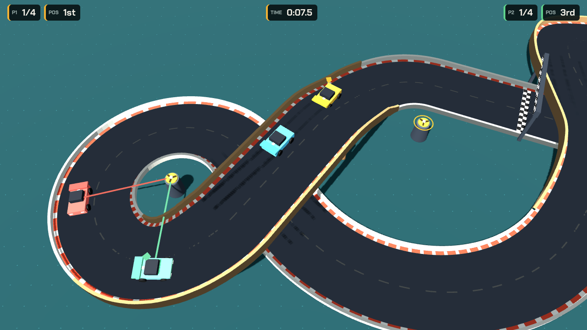
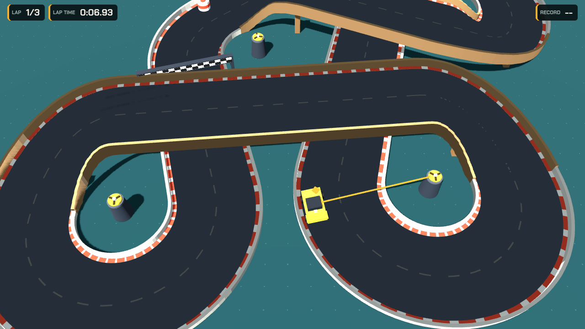
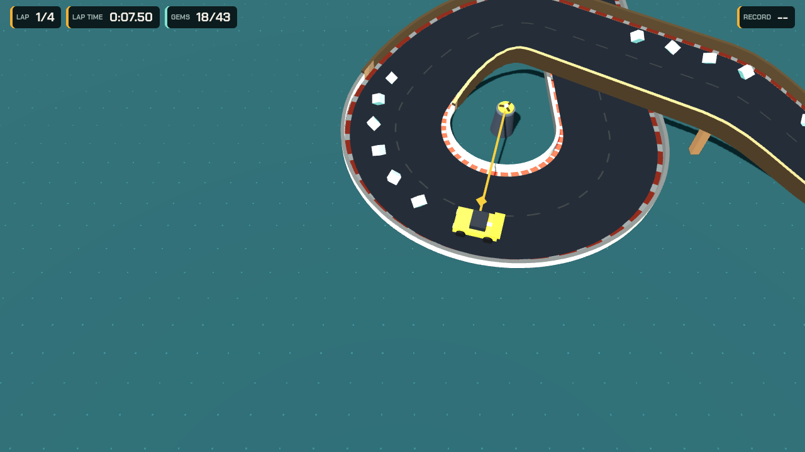

# Pivot Rush

An original slingshot-style racer for Android and iOS, built with **Godot 4.7** in 3D.
Your car only drives straight: hold to hook the nearest spinning tower, let the tether
whip you round the bend, release to slide out down the next straight.

This is the Godot port of the JS feel prototype (v32). The prototype is the spec: the
physics, tuning constants, the 17 track layouts, the 4 variants and the 2 modes are
ported 1:1, and the tracks build to the same geometry (checked against the prototype).

## Run it

1. Install Godot 4.7 (standard build, no .NET needed).
2. Open `project.godot` in the editor and press Play (F5).
3. Mouse click / touch and hold anywhere to hook, release to let go. Keyboard: Space (player 1), Enter (player 2).

## What's in the game

- **Modes:** Time trial (default, solo vs your ghost, sets records) and Race (vs AI rivals, 1 or 2 players on one device, split by screen halves).
- **Variants:** Standard, Reverse, Obstacles (breakable posts, +1 s each), Collect (gem line, +0.25 s per gem missed over the run).
- **Tracks:** 17 original layouts, from Lasso to Twin Bend, with bridges where the road crosses itself and jumps on some.
- **Records:** best lap (or Collect score) and the ghost lap are saved per track and variant in `user://records.cfg`. Races never set records.

## Code map

| File | What it does |
| --- | --- |
| `scripts/track_defs.gd` | Track layouts (towers), variants, driver roster |
| `scripts/track.gd` | Builds a track: centreline, tower anchors, bridges, start line, posts, gems, 3D heights |
| `scripts/race.gd` | The simulation: tether physics, icy slide, walls, jumps, laps, AI. Same tuning as the prototype |
| `scripts/world_view.gd` | 3D view: road mesh with kerbs and rails, bridge decks and ramps, towers, cars, tethers, effects, camera |
| `scripts/ui.gd`, `scripts/track_map.gd` | Menus, HUD, results, minimap and track thumbnails |
| `scripts/sfx.gd` | Synthesised blips and engine hum (no audio files) |
| `scripts/records.gd` | Time trial records and ghosts |
| `scripts/main.gd` | Game flow and input |

The simulation works in the prototype's 2D world units; the view maps `(x, y)` to 3D `(x, height, y) / 100`.
Gameplay stays 2D (bridges use a level index, as in the prototype), so the feel matches exactly.

## Tests

```sh
godot --headless --path . --import
godot --headless --path . --script tests/sim_test.gd    # AI must finish all 17 tracks x 4 variants
godot --headless --path . --script tests/build_test.gd  # prints track stats
```

CI runs the sim test on every pull request.

Screenshots without a GPU (software GL):

```sh
SHOT_DIR=/tmp/shots xvfb-run -a godot --path . --rendering-method gl_compatibility --fixed-fps 30 -- --demo=0,standard,16
```

`--demo=<track index>,<variant>,<seconds>[,race,<players>]` drives the game on autopilot and saves PNGs.

## Exporting

Presets for Android, iOS and Web are in `export_presets.cfg`. Install the 4.7.2 export templates
(Editor > Manage Export Templates) first.

- **Android:** set up the Android SDK and a keystore in Editor Settings, then Project > Export > Android. Package id `io.github.guillaumefont.pivotrush` (change it before publishing if you prefer another).
- **iOS:** needs a Mac with Xcode. Fill in your App Store team id in the iOS preset, export, then build the generated Xcode project.
- **Web (WASM):** single-threaded build, so it runs on any static host without special headers. Uses the Compatibility renderer.

The game uses the Mobile renderer on phones and the Compatibility renderer on the web.

## Screenshots




